{width="2.82in"}

**Historique des versions**

| Version | Date | Nom | Commentaire |
|---|---|---|---|
| 0.1 | 02/11/2026 | Moustafa Kayali (consultant SAP EWM) | Brouillon initial : extraits BPMN liés au flux retour, pour discussion avec le business |
| 0.2 | 02/11/2026 | Moustafa Kayali (consultant SAP EWM) | Compléments par flux BPMN et annexe des BR |
| 0.3 | 20/11/2026 | Moustafa Kayali (consultant SAP EWM) | Restructuration au format blueprint (TO BE), règles par étape, points ouverts déclarés |
| 0.4 | 20/11/2026 | Moustafa Kayali (consultant SAP EWM) | Corrections après relecture QA-004 : choix 108 / 922 et type de document de retour déclarés ouverts, branche du mouvement 108, éléments lus sur les figures marqués « à valider », annexe complétée |

# 1. Introduction

Ce document décrit les processus cibles de retour de marchandises vers le fournisseur et de mise à la mitraille du DC de Ronet, dans le modèle SAP EWM 2.0. Il couvre les marchandises refusées lors de la réception, lors du contrôle qualité ou à la suite d'un litige, depuis la décision de l'acheteur jusqu'à la sortie physique du DC.

Ces processus ne forment pas un flux BPMN autonome. Ils apparaissent comme des branches de sortie de plusieurs flux existants : réception, contrôle qualité, mise à disposition, création d'un bon sans référence et expédition. Ce document regroupe ces branches et précise, pour chacune, la règle TO BE applicable.

Deux flux sont hors scope du modèle SAP EWM 2.0 :

- Le retour de matériel défectueux vers Schaerbeek.
- La vente de mitraille.

Le flux de mitraille décrit dans ce document s'arrête donc au dépôt des articles dans l'emplacement dédié à la mitraille. La suite du traitement de la mitraille n'est pas couverte.

Point ouvert : l'annotation « Hors Scope : flux retour » du flux DC E2E (figure 1) contredit l'objet de ce document. L'annotation devra être précisée sur le BPMN, et la portée exacte du « flux retour » hors scope devra être confirmée (point ouvert 7).

Remarque : les éléments repris des figures BPMN sans texte correspondant dans le draft v0.2 sont marqués « lu sur la figure X, à valider ».

La section 2 présente la vue d'ensemble du flux. La section 3 décrit les origines d'un retour et la décision de l'acheteur. Les sections 4 et 5 décrivent les deux destinations possibles : la mitraille et le retour fournisseur. La section 6 traite de la traçabilité des unités de manutention (*handling unit*, HU) tout au long du flux.

**Aperçu des sous-processus de ce processus :**

| Sous-processus |
|---|
| Identifier les articles refusés et leur origine |
| Obtenir la décision de l'acheteur |
| Mettre les articles à la mitraille |
| Créer un bon sans référence pour le retour fournisseur |
| Préparer et consolider les articles à retourner |
| Expédier les articles vers le fournisseur |
| Tracer les HU tout au long du flux |

# 2. Vue d'ensemble – Flux DC E2E

Le flux DC E2E situe le retour fournisseur et la mitraille par rapport aux autres flux du DC. La figure ci-dessous montre l'annotation de périmètre portée sur ce flux :

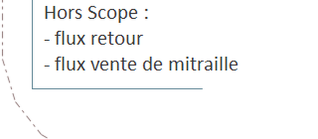{width="6.3in"}

Les articles refusés par le contrôle qualité et les articles stockés qui leur sont liés seront regroupés dans l'étape « Consolider échantillons + articles stockés ». Une décision oriente ensuite ces articles vers la mitraille ou vers le retour fournisseur. Le schéma suivant montre cette passerelle :

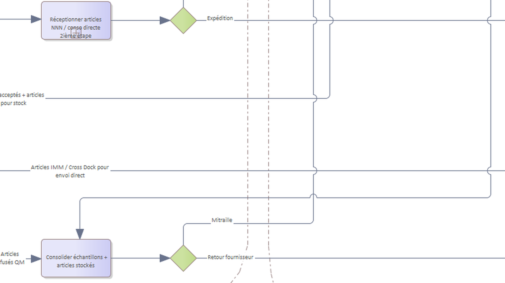{width="6.3in"}

Le retour fournisseur passera par la tâche « Créer un bon sans référence », décrite à la section 5.1. L'extrait ci-dessous montre cette tâche dans le flux DC E2E :

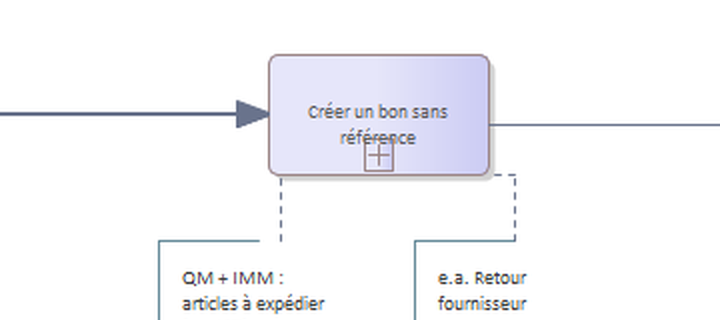{width="4.5in"}

# 3. Origines d'un retour et décision de l'acheteur

Un retour fournisseur ou une mise à la mitraille sera toujours déclenché par une décision de l'acheteur. Cette décision intervient après un refus de tout ou partie des articles livrés. Le refus peut provenir de plusieurs étapes du flux entrant, décrites aux sections 3.1 à 3.4.

Le traitement d'un article refusé dépend de sa situation de stock au moment de la décision. Les articles refusés avant leur réception en stock ne sont pas entrés en stock. Les articles refusés après leur mise en stock, comme les échantillons revenus du laboratoire, devront être sortis du stock lors de leur retour ou de leur mise à la mitraille.

Point ouvert : le mode de traçage et de sortie d'un retour fournisseur n'est pas tranché (BR-01-003-110 ; BR-02-002-040). Deux options restent ouvertes :

- L'option AS-IS : un mail et une diminution du stock en valeur (mouvement 108).
- Le flux retour standard : une livraison de retour référencée au PO et le mouvement 922.

Ce choix conditionne les sections 3.1.2, 3.1.4 et 5.1.2. Il est repris au point ouvert 6.

Le tableau suivant résume les scénarios :

| Scénario | Flux BPMN d'origine | Articles en stock EWM ? | Destinations possibles |
|---|---|---|---|
| Litige à la réception (incident, quantités refusées) | 3 – Réception étape 2 – Stock | Non, sauf branche du mouvement 108 (3.1.4) | Retour fournisseur, mitraille, articles acceptés |
| Quantités supplémentaires refusées ou toutes quantités refusées | 3 – Réception étape 2 – Stock | Non | Retour fournisseur, mitraille |
| Retour du contrôle qualité avec décision « Refusé » | 2B – Réception articles avec bon sans référence | Oui (articles QM stockés) | Retour fournisseur, mitraille, réparation par le fournisseur au DC |
| Litige sur une livraison NNN ou de consommation directe | 3B – Réception étape 2 – NNN / Consommation directe | Non | Retour fournisseur, mitraille |

## 3.1 Litige à la réception (étape 2 – Stock)

L'extrait suivant montre les branches de décision de l'acheteur dans le flux de réception étape 2 :

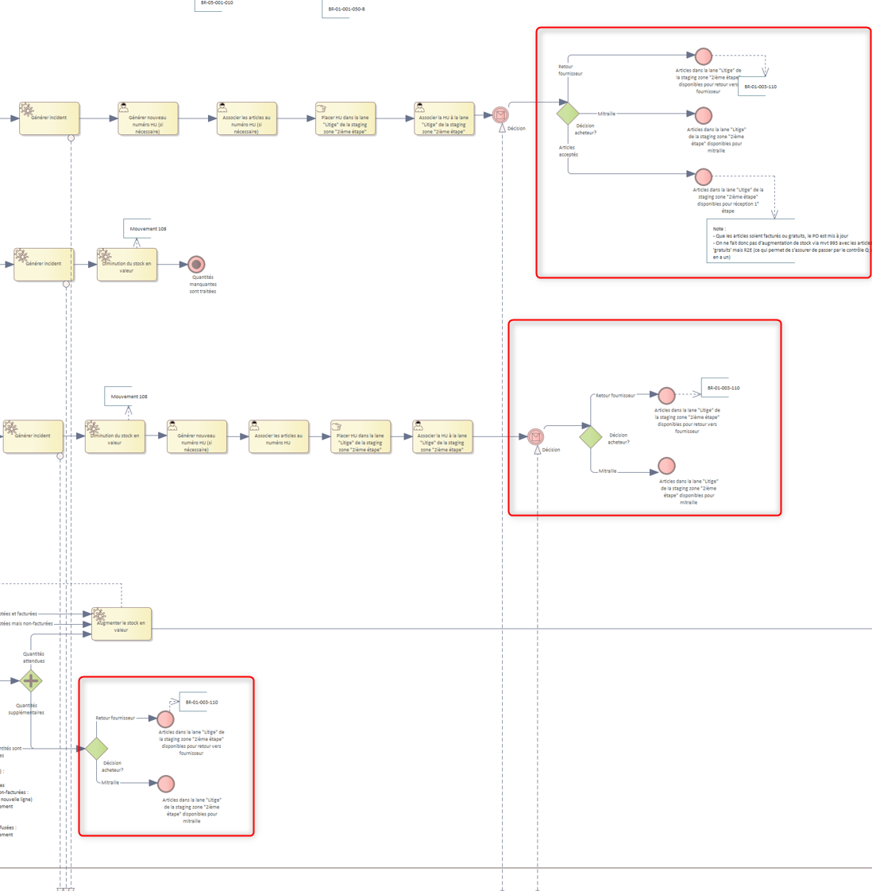{width="5.1in"}

### 3.1.1 Placer HU dans la lane « Litige » de la staging zone « 2ième étape »

Lorsqu'un incident est généré à la réception, le magasinier placera la HU concernée dans la lane « Litige » de la staging zone « 2ième étape ». Il associera ensuite la HU à cette lane dans le système.

Si les articles concernés ne disposent pas encore d'un numéro de HU, le magasinier générera un nouveau numéro de HU et y associera les articles avant de la placer dans la lane « Litige ».

Remarque : la lane « Litige » correspond aujourd'hui à la zone 990.

### 3.1.2 Décision acheteur ?

Les articles resteront dans la lane « Litige » jusqu'à la décision de l'acheteur. Trois décisions seront possibles :

- **Retour fournisseur** : les articles resteront dans la lane « Litige » et seront disponibles pour le retour vers le fournisseur (voir section 5, retour fournisseur).
- **Mitraille** : les articles resteront dans la lane « Litige » et seront disponibles pour la mitraille (voir section 4, mitraille).
- **Articles acceptés** : les articles seront disponibles pour la réception 1ère étape (lu sur la figure 4, à valider).

Les articles refusés ne seront pas réceptionnés : le mouvement 109 ne sera pas effectué. Le système devra tracer la quantité retournée au fournisseur, afin de documenter un éventuel litige de facturation (BR-01-003-110 ; GAP BR-01-003-110, à requalifier). Le mode de traçage reste à trancher entre les deux options décrites au chapitre 3 (point ouvert 6).

Remarque (note de la figure 4, branche « Articles acceptés », à valider) : que les articles soient facturés ou gratuits, le PO sera mis à jour. Les articles gratuits ne donneront donc pas lieu à une augmentation de stock par le mouvement 993, mais passeront par R2E. Ce passage permet de s'assurer que les articles passent par le contrôle qualité, s'il y en a un.

### 3.1.3 Quantités supplémentaires refusées ou toutes quantités refusées

Lors de la réception 1ère étape, l'acheteur peut refuser les quantités supplémentaires ou la totalité des quantités livrées. Dans ces deux cas, la livraison entrante 18\* sera mise à jour automatiquement (lu sur la figure 5, à valider). Les quantités refusées seront placées dans la lane « Litige » de la staging zone « 2ième étape », puis orientées vers le retour fournisseur ou la mitraille selon la décision de l'acheteur.

L'image ci-dessous montre cette branche dans le flux de réception étape 2 :

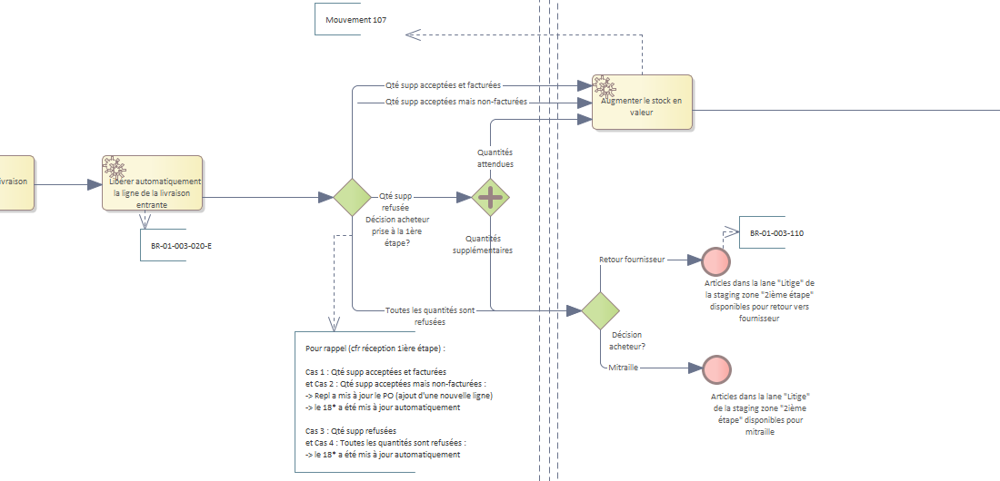{width="6.3in"}

Les quantités supplémentaires acceptées, facturées ou non, suivront le flux de réception normal. Le système augmentera alors le stock en valeur (mouvement 107). Pour ces quantités, Replenishment aura mis à jour le PO par l'ajout d'une nouvelle ligne, et la livraison entrante 18\* sera mise à jour automatiquement (note de la figure 5, à valider).

### 3.1.4 Diminution du stock en valeur

La figure 4 montre une seconde branche de litige. Après la génération de l'incident, le système diminuera le stock en valeur (mouvement 108). Le magasinier générera ensuite un nouveau numéro de HU si nécessaire et y associera les articles. Il placera la HU dans la lane « Litige » de la staging zone « 2ième étape » et l'associera à cette lane. L'acheteur décidera ensuite d'un retour fournisseur ou d'une mise à la mitraille (lu sur la figure 4, à valider).

Une branche voisine de la même figure diminue aussi le stock en valeur (mouvement 108) pour traiter les quantités manquantes.

Point ouvert : la condition qui déclenche cette branche n'est pas lisible sur l'extrait. Elle correspond à l'option AS-IS (mail et mouvement 108) du point ouvert 6 (point ouvert 8).

## 3.2 Retour du contrôle qualité (réception avec bon sans référence)

Les échantillons envoyés au laboratoire pourront revenir au DC. Ils seront réceptionnés par le flux « Réception articles avec bon sans référence », avec la provenance « Retour contrôle Q ». La figure suivante montre cette passerelle de provenance :

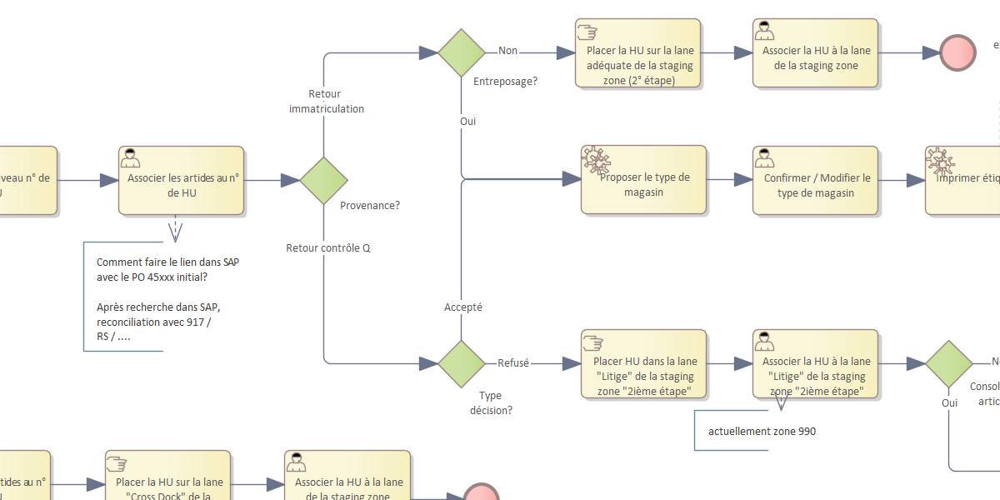{width="6.3in"}

### 3.2.1 Type décision ?

Si la décision du contrôle qualité est « Accepté », la HU suivra le flux d'entreposage normal : le système proposera un type de magasin, que le magasinier confirmera ou modifiera.

Si la décision est « Refusé », le magasinier placera la HU dans la lane « Litige » de la staging zone « 2ième étape », puis l'associera à cette lane dans le système.

Le coordinateur n'est pas nécessairement informé du retour d'un échantillon du laboratoire. Le système devra lui donner la visibilité sur les articles revenus du laboratoire avec une décision de refus (BR-02-002-020 ; GAP possible BR-02-002-020).

Point ouvert : le lien dans SAP entre l'échantillon retourné et le PO 45\* initial reste à définir. Une réconciliation par le mouvement 917 ou la réservation est envisagée.

### 3.2.2 Consolider échantillon + articles QM stockés ?

Le système proposera de consolider l'échantillon refusé avec le reste des articles QM stockés du même lot d'inspection. Le magasinier consolidera ensuite l'échantillon et les autres articles concernés. La figure suivante montre ces deux étapes :

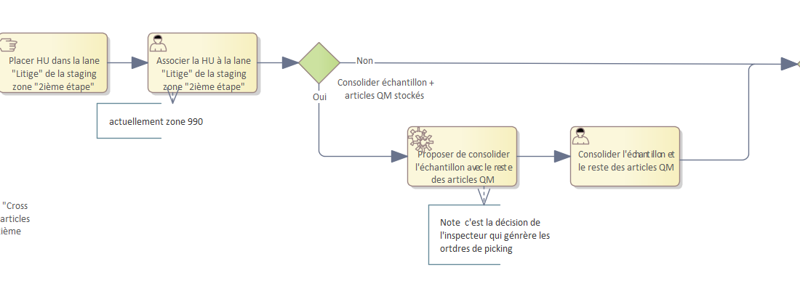{width="6.3in"}

La décision de l'inspecteur générera les ordres de prélèvement de ces articles.

Si aucune consolidation n'est nécessaire, le flux se poursuivra directement vers la décision de l'acheteur (lu sur la figure 7, à valider).

### 3.2.3 Décision acheteur ?

Trois décisions seront possibles après un refus du contrôle qualité :

- **Réparation par le fournisseur au DC** : les articles seront disponibles pour la réception 1ère étape (lu sur la figure 8, à valider).
- **Retour fournisseur** : les articles seront disponibles pour le retour vers le fournisseur (voir section 5).
- **Mitraille** : les articles seront disponibles pour la mitraille (voir section 4).

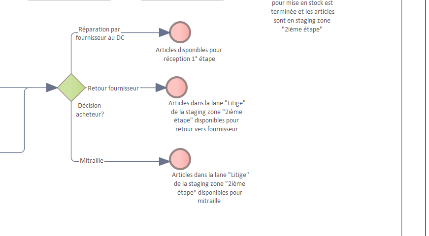{width="5.2in"}

Le système devra indiquer au coordinateur si les articles refusés doivent être retournés au fournisseur ou mis à la mitraille.

## 3.3 Litige sur une livraison NNN ou de consommation directe

Pour les articles NNN et de consommation directe, le retour fournisseur et la mitraille à la suite d'une anomalie se feront sans mouvement de stock.

En cas de litige, le magasinier déplacera toutes les HU de la livraison entrante vers la lane « Litige » de la staging zone « 2ième étape ». Il les associera ensuite à cette lane dans le système.

Après la décision de l'acheteur, le flux BPMN prévoit deux cas :

- Si au moins un article de la livraison est refusé, toute la livraison entrante 18\* sera clôturée. Les articles refusés seront alors disponibles pour le retour fournisseur ou pour la mitraille.
- Si tous les articles litigieux de la livraison sont acceptés, toutes les lignes de la livraison entrante 18\* seront débloquées, et la réception se poursuivra.

Les notes « Pour BRM » de la figure 9 expriment deux besoins, à qualifier (standard ou GAP) :

- Bloquer toute la livraison entrante en cas de litige, et non la seule HU concernée.
- Passer le statut de la livraison entrante 18\* à « clôturé » lorsqu'au moins un article est refusé.

Ces besoins ne portent pas encore de référence BR ni GAP (point ouvert 9).

L'image ci-dessous montre ce flux :

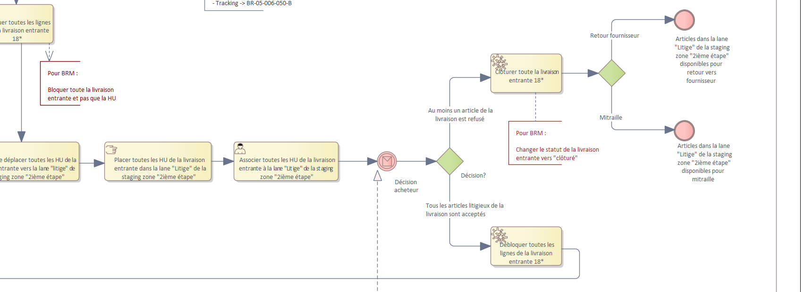{width="6.3in"}

## 3.4 Vérification documentaire

Le flux de vérification documentaire (flux BPMN 1) n'est pas concerné par le retour fournisseur ni par la mitraille.

# 4. Mitraille

La mitraille est la mise au rebut des articles refusés. Après la décision de l'acheteur, les articles concernés seront déposés dans l'emplacement dédié à la mitraille, et le flux de mitraille du DC sera alors terminé. La vente de la mitraille est hors scope (voir section 1).

Le traitement diffère selon que les articles sont en stock ou non :

- Pour les articles refusés au contrôle qualité et stockés, toutes les quantités refusées seront transférées vers l'emplacement dédié à la mitraille, qu'il s'agisse du lot entier ou d'une quantité partielle. La consommation des articles dans l'emplacement mitraille sera automatique.
- Pour les articles refusés avant leur entrée en stock (litige à la réception, NNN et consommation directe), le dépôt dans l'emplacement mitraille se fera sans mouvement de stock.

Le dépôt physique suivra le sous-processus « Mettre à disposition » (flux BPMN 5B), décrit ci-dessous.

## 4.1 Mettre à disposition vers l'emplacement mitraille

Le sous-processus « Mettre à disposition » traitera les porteurs dont les HU doivent être déplacées vers une destination sur site. Les porteurs à mettre à la mitraille, à la suite d'une décision de l'acheteur en réception étape 2, feront partie de ces porteurs.

L'image suivante montre le flux « Mettre à disposition » :

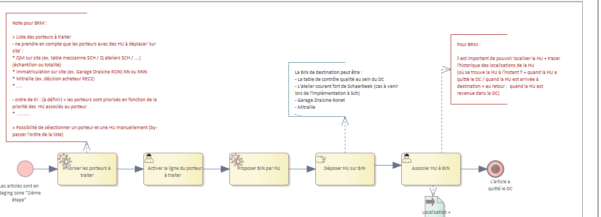{width="6.3in"}

### 4.1.1 Prioriser les porteurs à traiter

Le système affichera la liste des porteurs à traiter. Selon la note « Pour BRM » de la figure 10, besoin à qualifier, cette liste ne reprendra que les porteurs dont les HU doivent être déplacées sur site, notamment :

- Le contrôle qualité sur site (par exemple la table mezzanine ou les ateliers de Schaerbeek), pour un échantillon ou la totalité.
- L'immatriculation sur site (par exemple le garage draisine de Ronet), pour des articles NNN ou non.
- La mitraille, par exemple à la suite d'une décision de l'acheteur en réception étape 2.

Le système triera les porteurs selon la priorité des HU qui leur sont associées. L'ordre de tri reste à définir.

Le magasinier peut sélectionner manuellement un porteur et une HU, sans suivre l'ordre de la liste.

### 4.1.2 Activer la ligne du porteur à traiter

Le magasinier activera la ligne du porteur qu'il va traiter.

### 4.1.3 Proposer BIN par HU

Le système proposera un emplacement de destination pour chaque HU. Pour une HU à mettre à la mitraille, l'emplacement proposé sera l'emplacement « Mitraille ».

Remarque : selon la destination, l'emplacement proposé peut aussi être la table de contrôle qualité du DC, l'atelier courant fort de Schaerbeek (lors de l'implémentation à Schaerbeek) ou le garage draisine de Ronet.

### 4.1.4 Déposer HU sur BIN

Le magasinier déposera physiquement la HU sur l'emplacement proposé.

### 4.1.5 Associer HU à BIN

Le magasinier associera la HU à l'emplacement dans le système. Pour la mitraille, le flux sera alors terminé.

# 5. Retour fournisseur

Le retour fournisseur est le renvoi au fournisseur des articles refusés, sur décision de l'acheteur. Le renvoi se fera toujours sur la base d'un document lié au PO initial (BR-02-002-040). La référence de ce document sera envoyée manuellement au fournisseur par Replenishment. Le transporteur s'en servira pour prendre rendez-vous et identifier la marchandise à enlever.

Le retour fournisseur suivra trois étapes :

- La création d'un bon sans référence, qui portera les HU à retourner (section 5.1).
- La préparation et la consolidation des articles à retourner, lorsqu'ils sont en stock (section 5.2).
- L'expédition vers le fournisseur (section 5.3).

## 5.1 Créer un bon sans référence

Le coordinateur DC créera un bon d'expédition sans référence pour les HU à retourner au fournisseur. L'image ci-dessous montre le flux « Création bon sans référence » :

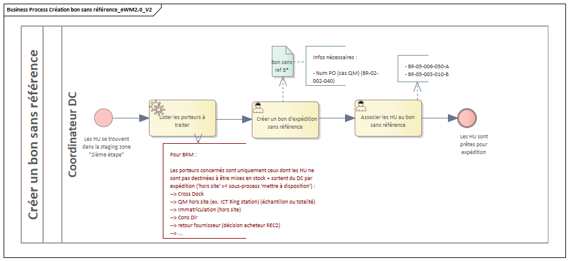{width="6.3in"}

### 5.1.1 Lister les porteurs à traiter

Le système listera les porteurs à traiter. Selon la note « Pour BRM » de la figure 11, besoin à qualifier, ce sous-processus ne concernera que les porteurs dont les HU ne sont pas destinées à être mises en stock et qui sortiront du DC par expédition :

- Le cross dock.
- Le contrôle qualité hors site (par exemple l'ICT Ring station), pour un échantillon ou la totalité.
- L'immatriculation hors site.
- La consommation directe.
- Le retour fournisseur, à la suite d'une décision de l'acheteur en réception étape 2.

Remarque : les porteurs déplacés vers une destination sur site, dont la mitraille, ne relèvent pas de ce sous-processus mais du sous-processus « Mettre à disposition » (voir section 4.1, mettre à disposition vers l'emplacement mitraille).

### 5.1.2 Créer un bon d'expédition sans référence

Le coordinateur créera le bon d'expédition sans référence. Pour un retour fournisseur issu du contrôle qualité, le numéro du PO devra être renseigné sur le bon (note « Num PO (cas QM) » de la figure 11 ; BR-02-002-040).

Dans l'option du flux retour standard, le déclenchement du retour fournisseur sur la livraison entrante du fournisseur externe créera un bon 8\* lié au PO initial. Lors de la sortie de marchandises de ce bon 8\*, le mouvement 922 sera visible sur le PO.

Point ouvert : le type de document de retour reste à trancher (BR-02-002-040). Il peut s'agir d'un bon d'expédition sans référence qui porte le numéro du PO, ou d'une livraison de retour référencée au PO, c'est-à-dire le bon 8\* lié au PO initial avec le mouvement 922. Ce choix dépend de l'option retenue pour BR-01-003-110 (point ouvert 6).

Point ouvert : le moment où le mouvement 922 sera déclenché reste à confirmer, après DU ou après l'exécution du retour fournisseur dans EWM.

### 5.1.3 Associer les HU au bon sans référence

Le coordinateur associera les HU à retourner au bon sans référence (BR-05-006-050-A ; BR-05-003-010-B). Les HU seront alors prêtes pour l'expédition.

## 5.2 Préparer et consolider les articles à retourner

Pour les articles refusés au contrôle qualité et stockés, le coordinateur pourra déclencher le retour fournisseur une fois les articles rangés dans les emplacements qualité. Ce déclenchement créera le bon 8\* et permettra de prélever les quantités refusées, en lot entier ou en quantité partielle.

Le prélèvement consolidera les échantillons stockés dans les emplacements qualité et les articles liés au même lot d'inspection. Ces articles seront consolidés pour l'expédition vers le fournisseur.

Pour les articles refusés avant leur entrée en stock, aucun prélèvement ne sera nécessaire : les HU se trouvent déjà dans la lane « Litige » de la staging zone « 2ième étape ».

## 5.3 Expédier les articles vers le fournisseur

Le retour fournisseur suivra le flux d'expédition (flux BPMN 9). L'extrait suivant montre les étapes de chargement et de sortie des HU :

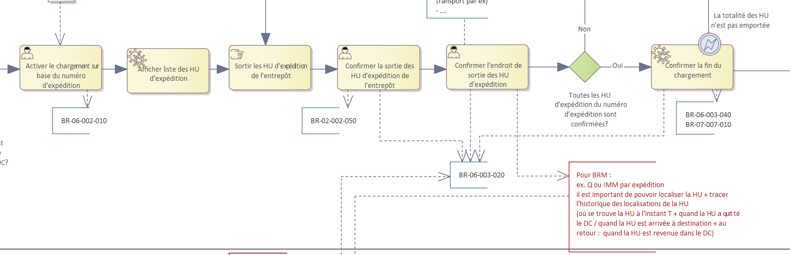{width="6.3in"}

### 5.3.1 Activer le chargement sur base du numéro d'expédition

Le coordinateur pourra créer une référence unique qui regroupera plusieurs HU, afin d'identifier sans ambiguïté la marchandise à enlever (BR-06-002-010). Cette référence unique sera remise au fournisseur. Le transporteur se présentera au comptoir avec cette référence.

Le magasinier activera le chargement sur la base de ce numéro d'expédition.

### 5.3.2 Afficher liste des HU d'expédition

Le système affichera la liste des HU d'expédition associées au numéro d'expédition. Le magasinier identifiera ainsi les HU liées au retour grâce au numéro de transport et aux numéros de HU.

### 5.3.3 Sortir les HU d'expédition de l'entrepôt

Le magasinier sortira les HU d'expédition de l'entrepôt.

### 5.3.4 Confirmer la sortie des HU d'expédition de l'entrepôt

Le magasinier devra scanner chaque HU refusée au moment de son enlèvement (BR-06-003-020). Ce scan permettra de contrôler que le transporteur enlève la bonne HU, même lorsque le même matériel se trouve dans la même zone (BR-02-002-050 ; GAP BR-02-002-050).

Point ouvert : la qualification en GAP reste à confirmer. Le rattachement de la HU à l'unité de transport et à une porte pourrait suffire à couvrir ce besoin en standard.

### 5.3.5 Confirmer l'endroit de sortie des HU d'expédition

Le magasinier confirmera l'endroit par lequel les HU d'expédition quittent le DC (BR-06-003-020).

Point ouvert : le blueprint Outbound marque cette confirmation comme GAP. Comme en 5.3.4, la TU et la porte pourraient couvrir ce besoin en standard (point ouvert 4).

### 5.3.6 Confirmer la fin du chargement

Lorsque toutes les HU du numéro d'expédition seront confirmées, le système confirmera la fin du chargement (BR-06-003-040 ; BR-07-007-010).

Si la totalité des HU n'est pas emportée, le flux suivra la branche « HU prévues et non emportées » du flux d'expédition (lu sur la figure 12, à valider).

# 6. Traçabilité des HU

Les HU de retour fournisseur seront gérées et identifiées dans EWM tant qu'elles se trouvent dans le magasin, afin de garantir la traçabilité complète (BR-02-002-010). Ce besoin découle du principe d'entrepôt géré par HU (*HU-managed warehouse*) appliqué à tout le flux E2E.

Le système permettra de localiser une HU à tout instant et de consulter l'historique de ses localisations. Cet historique couvrira notamment le moment où la HU a quitté le DC, son arrivée à destination et, en cas de retour, le moment où elle est revenue au DC. La figure suivante reprend la note du flux d'expédition qui porte ce besoin :

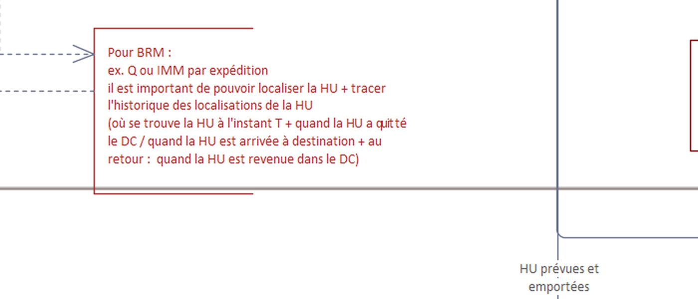{width="5in"}

Le cockpit de suivi permettra à l'agent de suivre les étapes de refus et de renvoi du matériel, ainsi que les échantillons ou lots revenus du laboratoire (BR-02-002-020 ; GAP possible BR-02-002-020). Grâce à cette information, le coordinateur pourra déclencher le retour fournisseur.

Le système devra permettre d'identifier le matériel refusé, en totalité ou en partie, pour le retour fournisseur (BR-02-002-030 ; GAP BR-02-002-030).

Point ouvert : l'identification se fera par une étiquette ou par une information dans le système. Le choix reste à préciser.

# 7. Points ouverts

| N° | Point ouvert | Section | Responsable |
|---|---|---|---|
| 1 | Moment du déclenchement du mouvement 922 : après DU ou après l'exécution du retour fournisseur dans EWM | 5.1.2 | À définir |
| 2 | Lien dans SAP entre l'échantillon retourné du laboratoire et le PO 45\* initial (réconciliation par le mouvement 917 ou la réservation) | 3.2.1 | À définir |
| 3 | Identification du matériel refusé : étiquette ou information système (BR-02-002-030) | 6 | À définir |
| 4 | Qualification en GAP du contrôle par scan de la HU refusée à l'enlèvement et de la confirmation de l'endroit de sortie (BR-02-002-050) | 5.3.4 ; 5.3.5 | À définir |
| 5 | Ordre de tri des porteurs à traiter dans « Mettre à disposition » | 4.1.1 | À définir |
| 6 | Mode de traçage et de sortie du retour fournisseur : option AS-IS (mail et mouvement 108) ou flux retour standard (livraison de retour et mouvement 922), et type de document de retour (bon sans référence portant le PO ou bon 8\* lié au PO) (BR-01-003-110 ; BR-02-002-040) | 3 ; 3.1.2 ; 5.1.2 | Bernard (owner GAP BR-01-003-110), Replenishment |
| 7 | Portée de l'annotation « Hors Scope : flux retour » du flux DC E2E, et sens de la phrase inachevée de la v0.2 (« Le flux retour qui est hors s… ») | 1 | Moustafa |
| 8 | Condition de déclenchement de la branche « Diminution du stock en valeur » (mouvement 108) de la figure 4 | 3.1.4 | À définir |
| 9 | Qualification des besoins « Pour BRM » sur la livraison NNN : blocage de toute la livraison et statut « clôturé » | 3.3 | À définir |

# Annexe – BR relatifs au retour et à la mitraille

Cette annexe liste les BR du fichier Business Requirements qui concernent le retour fournisseur, le flux retour et la mitraille. La colonne « Section » renvoie à la règle TO BE de ce document.

| BR | Exigence (résumé) | Statut GAP List 27-10 | Section |
|---|---|---|---|
| BR-01-003-110 | Tracer le retour d'une quantité vers le fournisseur si l'acheteur refuse tout ou partie de la livraison, pour documenter un litige de facturation | Inbound – Enhancement – Analysé – Complexité M (GAP à requalifier) | 3.1.2 |
| BR-02-002-010 | Gérer des HU pour le retour fournisseur, identifiées dans EWM tant qu'elles sont dans le magasin | QM – GAP possible – À analyser | 6 |
| BR-02-002-020 | Suivre au scanner les étapes de refus et de renvoi du matériel | QM – GAP possible – À clarifier avec le business | 3.2.1 ; 6 |
| BR-02-002-030 | Identifier par étiquette le matériel refusé, en totalité ou en partie, pour le retour fournisseur | QM – Form – À clarifier avec le business | 6 |
| BR-02-002-040 | Renvoyer le matériel sur la base d'un document lié au PO, dont la référence sert au transporteur | QM – Couvert par : Standard – FRICE à déterminer – À analyser (à aligner avec GAP BR-01-003-110) | 5 ; 5.1.2 |
| BR-02-002-050 | Contrôler que le transporteur enlève la bonne HU refusée, par scan à l'enlèvement | Outbound et QM – À clarifier avec le business | 5.3.4 |
| BR-06-002-010 | Créer une référence unique regroupant plusieurs HU, remise au fournisseur | Absent de la GAP List 27-10 | 5.3.1 |
| BR-05-006-050-A | Associer les HU NNN / consommation directe au bon sans référence (HU d'expédition) | NNN – BR-05-006-050 couvert – Standard Infrabel – Analysé | 5.1.3 |
| BR-05-003-010-B | HU liées à un bon 8\* sans référence | NNN – deux lignes : BR-05-003-010 Standard Infrabel, et GAP à qualifier (ID à attribuer) – Analysé | 5.1.3 |
| BR-06-003-020 | Confirmer la sortie et l'endroit de sortie des HU d'expédition | Absent de la GAP List 27-10 | 5.3.4 ; 5.3.5 |
| BR-06-003-040 | Lien de tracking transporteur associé à la HU / au numéro d'expédition | Outbound – Gap – Enhancement + Interface – Analysé | 5.3.6 |
| BR-07-007-010 | Indicateurs OTIF des transports | Reporting – GAP – Report (KPI) – Analysé | 5.3.6 |
